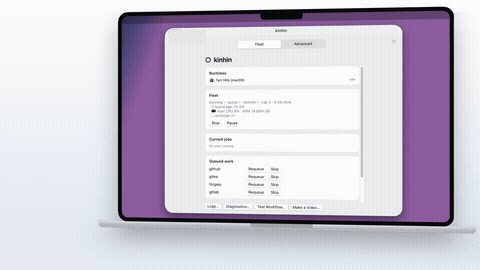

<p align="center"></p>

# kinhin ○

**Commit it. Screenshot it. Ship it.** Your Mac is your CI, your screenshot studio and your video studio.

Ephemeral, autoscaling runners for GitHub Actions, Gitea and Forgejo Actions and GitLab CI/CD, plus store screenshots and
narrated launch videos built from files in your repo.

**[kinhin.dev](https://kinhin.dev)** · [Quick start](https://kinhin.dev/guide/quick-start) ·
[Beta 3](https://kinhin.dev/blog/beta-3)

<!-- docs-sync:begin release-banner -->
> **Beta (`v0.0.1-beta-3`).** Supported: GitHub, Gitea, Forgejo and GitLab CE. See
> [what has been tested](docs/forges.md#what-has-been-tested) and the [roadmap](docs/beta-roadmap.md), and
> [report what you find](https://github.com/RabinApps/kinhin/issues/new/choose). No telemetry.
<!-- docs-sync:end release-banner -->

**Sponsored by [SupDesk](https://supdesk.app)**, the feedback and support console for solo founders, devs and small teams.
Want to become a sponsor? [See how](docs/support.md#become-a-sponsor).

[](https://kinhin.dev/launch.mp4)

*The kinhin launch video, built from files in this repo. [Watch it](https://kinhin.dev/launch.mp4).*

## What it does

- **CI that scales to your queue.** Self-hosted runners appear for one job and are gone when it ends.
- **Store screenshots in every locale.** One fastlane lane for iOS, Android, Flutter, React Native and KMP.
- **Videos that rebuild with your release.** A config in your repo becomes a narrated launch video.

## Requirements

- Apple Silicon Mac, macOS 15+, ~60 GB free disk ([sizing](docs/hardware.md))
- An access token for your [forge](docs/forges.md), such as a GitHub PAT with `repo` scope

## Install

```bash
curl -fsSL https://github.com/RabinApps/kinhin/releases/latest/download/install.sh | bash
```

Pinned versions, uninstall and updates: [Install](docs/install.md).

## Quick start

```bash
kinhin setup repair tart                 # install tart; `kinhin doctor` checks the Mac
kinhin config init                       # starter config: set accounts: and labels
kinhin auth set                          # store your token in the Keychain
kinhin image prepare && kinhin start     # bake the runner image, then run the fleet
```

Point a workflow at it and watch with `kinhin watch`:

```yaml
jobs:
  build:
    runs-on: [self-hosted, macos, arm64]
```

Prefer a GUI? Launch **kinhin** from Applications. Full walkthrough: [Quick start](website/guide/quick-start.md).

## Documentation

| | |
| --- | --- |
| **Get started** | [Why kinhin](docs/why.md) · [Install](docs/install.md) · [Configuration](website/guide/config.md) · [The app](docs/app.md) |
| **Run your fleet** | [Runtimes](docs/runtimes.md) · [Scaling](docs/scaling.md) · [Toolchains](docs/toolchains.md) · [Healing](docs/healing.md) · [Telemetry](docs/telemetry.md) · [Hardware](docs/hardware.md) |
| **Mobile releases** | [fastlane](docs/mobile-fastlane.md) · [Store screenshots](docs/mobile-screenshots.md) · [Credentials](docs/mobile-credentials.md) |
| **Product videos** | [Add videos to your project](docs/videos-for-your-project.md) · [Video config](docs/video-config.md) · [Gallery](docs/video-gallery.md) |
| **Reference** | [CLI commands](https://kinhin.dev/cli/commands) · [Forges](docs/forges.md) · [Agents & MCP](docs/agents.md) · [Architecture](docs/architecture.md) |
| **Help** | [Troubleshooting](website/guide/troubleshooting.md) · [Security](docs/security.md) · [Roadmap](docs/beta-roadmap.md) |

Run `kinhin --help` for the command list.

## Contributing and support

See [CONTRIBUTING.md](CONTRIBUTING.md). kinhin is free; [support it](docs/support.md) or
[add your project to the list](docs/used-by.md). More from Rabin Apps: [SupDesk](https://supdesk.app/en).

## License

Copyright © 2026 Rabin Apps, LLC. Licensed under the [Apache License 2.0](LICENSE).
kinhin shells out to [Tart](https://tart.run) and links [Yams](https://github.com/jpsim/Yams) (both Apache-2.0); see [NOTICE](NOTICE).
