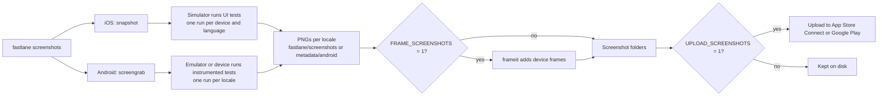
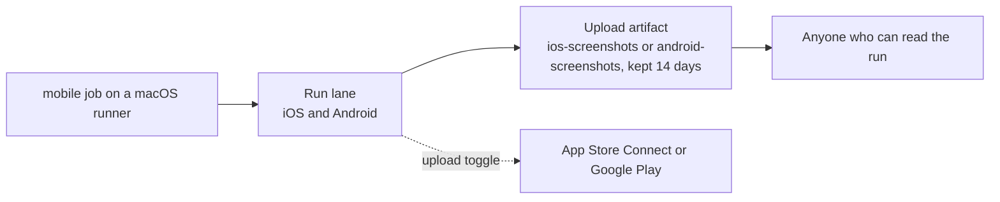
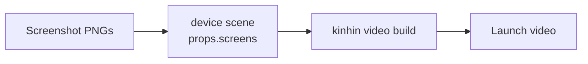

# Architecture: screenshots

How `kinhin mobile init` sets up store screenshots, what the lane does on each platform, and how the screenshots leave the
VM. This page is a companion to the [architecture overview](architecture.md); the setup guide is
[Store screenshots with fastlane](mobile-screenshots.md).

[← Back to architecture](architecture.md)

## Scope

Screenshots are a fastlane job, not a kinhin runtime. kinhin scaffolds the files and runs the workflow on a runner, and
fastlane does the capture, framing and upload. kinhin never edits your Xcode project or your Gradle files, because a
script that edits them is easy to break. Those steps are manual and documented in the setup guide.

## Scaffolding

`Sources/KinhinKit/Mobile/` holds the templates and scaffold logic. `kinhin mobile init` writes three kinds of file:

| Written by kinhin | Where | Purpose |
|---|---|---|
| Lane | The project's `fastlane` folder (`screenshots` lane) | Calls `snapshot` on iOS or `screengrab` on Android |
| Settings | `fastlane/Snapfile`, `fastlane/Framefile.json`, `fastlane/Screengrabfile` | Devices, languages, frames, locales |
| Sample UI tests | `UITests/` (iOS), `app/src/androidTest/java/screenshots/` (Android) | The screens fastlane photographs |

You still add the UI test target to the Xcode project, and the instrumented test source set to Gradle.

## Capture on each platform

The lane exits 0 only when at least one PNG exists, so an empty run fails loudly rather than passing silently. Upload is
off unless you turn it on, and framing is optional.

Each platform's settings map to fastlane's own options. Variables set in the CI workflow choose the devices, languages,
locales and frame and upload toggles. The full list is in the [settings table](mobile-screenshots.md#settings-from-ci).

## CI flow

The CI job runs the lane on the macOS runner, then uploads the screenshots as a workflow artifact. The VM is deleted when
the job ends, so the artifact is the only copy that survives.

Upload the artifact even when the lane fails, so the partial screenshots are available for debugging. Because anyone who
can read the run can open the artifact, the sample screens use test accounts and fake data.

The Android job runs on the same macOS runner as iOS. screengrab needs an emulator or device on that runner, which the
runner image must provide. The setup has not been verified on a runner.

## From screenshots to a video

Screenshots can feed a launch video. A `device` scene in a project's video file takes PNG paths as `props.screens` and shows
them as a cross-fading slideshow. The `mobile-capture` job in the video workflow captures them for a look that sets
`screens`.

See [making a video](making-a-video.md#screenshots-as-a-scene) and [CI video](ci-video.md#store-screenshots-in-the-mobile-cut)
for the details.
