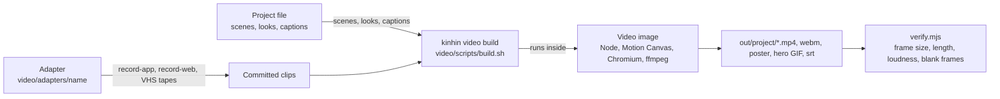
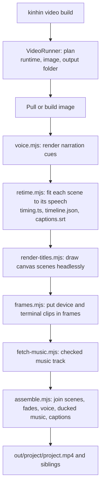
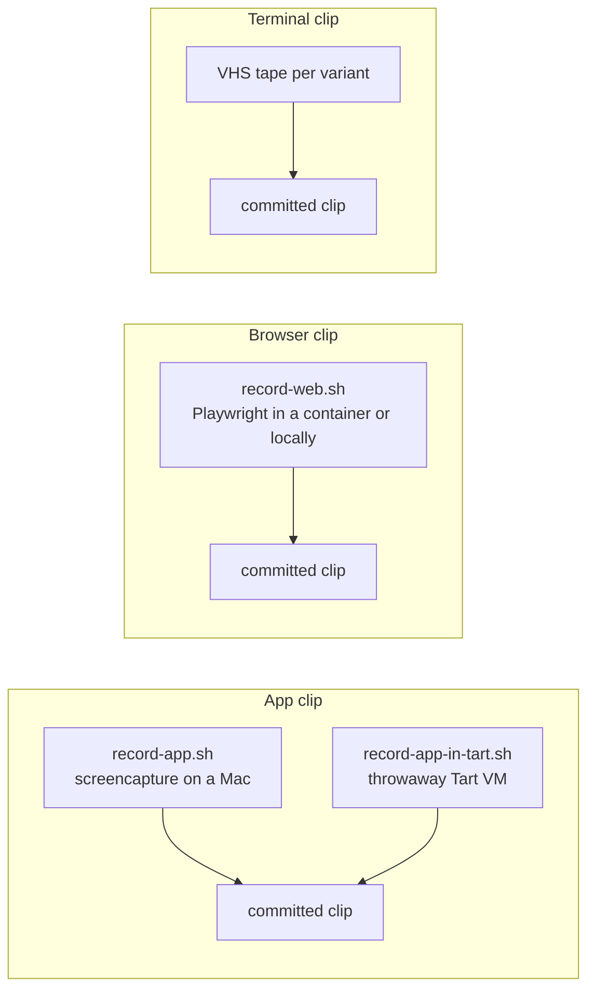
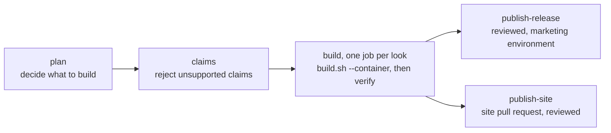

# Architecture: videos

How `kinhin video` turns a repository's video project into an MP4, and how the marketing video runs in CI. This page is
a companion to the [architecture overview](architecture.md); the product-facing guides are [Videos for your project](videos-for-your-project.md),
[Making kinhin's demo video](making-a-video.md) and [Marketing video in CI](ci-video.md).

[← Back to architecture](architecture.md)

## The two halves

A video build has two halves that never share state beyond the output folder:

1. **Capture.** Adapters record the product (an app window, a terminal session, a browser session). Recording happens on
   the host or in a throwaway VM, and each clip is committed under the adapter folder.
2. **Render.** The build runs inside a container image, so a Linux runner can produce the same file as a Mac. It turns the
   project file, the clips and the narration into scenes, then assembles them.

Only the render half needs the container runtime. The capture half needs a Mac for app clips, which is why app recordings
are committed rather than rebuilt in CI.

## Local build, step by step

`kinhin video build` plans the run, picks a runtime, makes sure the image exists, and then runs the steps below in the
container. The runner (`VideoRunner`) decides which runtime to use: `preferred` if given, else Apple's `container` when its
service is running, else Docker when its daemon answers. Missing images are pulled once; the first pull is about a
gigabyte.

Scene renders are cached under `.kinhin/videos/.cache`, so a second build after a one-line edit only re-renders the
scenes that changed. The `out/.work/` folder is scratch and is removed by the container build.

## Scene types

A project is a list of scenes. Each scene is one of two kinds, and the pipeline does not know about any product:

| Kind | Drawn by | Source of the pixels |
|---|---|---|
| Canvas scene (title, statement, queue, parallel, map, outro) | Motion Canvas, rendered headlessly | The project file's text and theme |
| Clip scene (`device`, `terminal`, `browser`) | Clip framing in `frames.mjs` | A committed recording from the adapter |

Everything specific to one product lives in the adapter: `video/adapters/<name>/`, with its recorders, tape files, committed
clips and claims rules.

## Capture paths

Browser clips need no Mac, no desktop session and no permission grant, so they are the easiest path for anything that runs
in a browser. Terminal clips run the real CLI from a debug build in a throwaway support folder.

The demo app for kinhin's own video is a debug-only `FleetServing` (`Sources/kinhin-app/Demo/`) that replays a script. It
touches no config, Keychain, daemon or forge.

## Verification

`video/scripts/verify.mjs` is the same checker the end-to-end tests use. A video that fails it is not published. It checks:

- the frame size and the length against the timeline,
- an audio track near -16 LUFS,
- no black frames,
- one caption per cue,
- a poster and a hero GIF that are not blank,
- the size and length budgets.

`kinhin video validate` checks the project and its claims without rendering, so a bad claim fails fast.

## CI

The marketing video runs as a GitHub Actions workflow. Publishing is the only part that touches the release or the site.

- **plan** works out which looks to build, in seconds.
- **claims** is the honesty gate. It reads `video/adapters/<name>/claims.json` and the project file, and it fails a video
  that says something the product does not support.
- **build** pulls the image published for the release (`ghcr.io/rabinapps/kinhin-video:<version>`) when there is one, and
  builds it from the checked-out sources otherwise. It then runs the same checks as `verify.mjs` and writes a summary.
- **publish** steps run only after a build succeeds, and only behind the `marketing` environment, so a person approves them.

A failed video job never blocks a release, a docs deploy or a pull request, because nothing depends on it.
