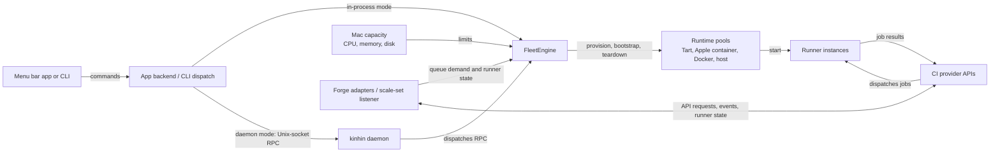
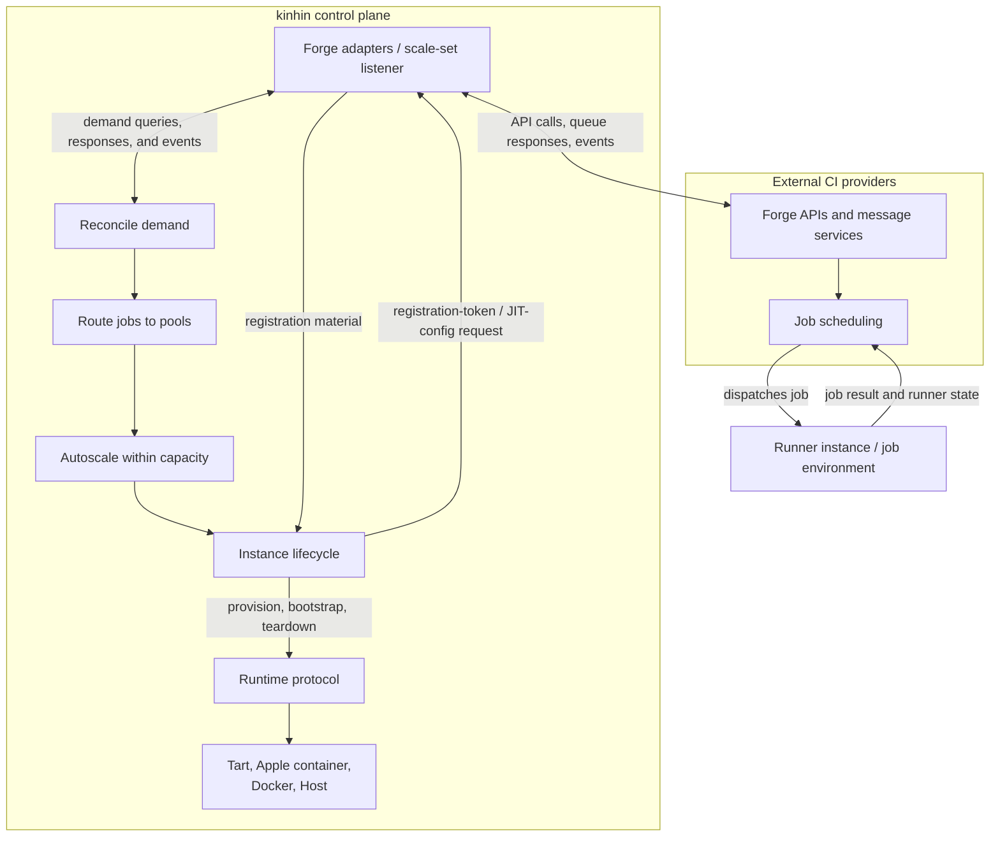
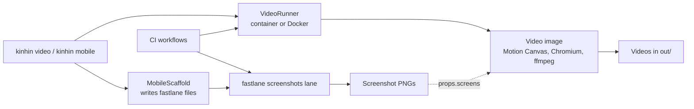

# Architecture

How the Swift package is laid out, what the tests cover, and what CI runs.

[← Back to README](../README.md)

Contributor conventions (layout, style, error handling, formatting) are in [CONTRIBUTING.md](../CONTRIBUTING.md).

## High-level overview

A fleet runs on a Mac. The app or CLI controls it either through an in-process engine or, in daemon mode, over a private Unix socket. The engine gets demand and runner state from forge APIs, then provisions runtime instances within the host's capacity budget.



Job completion is observed through provider runner state or events; runners do not report completion directly to `FleetEngine`. The engine reconciles demand and runtime state, and removes ephemeral instances when their runners finish. Beside the reconcile loop, the healing agent (`Fleet/Healing/`) runs its own loop: it turns alerts, records, the spawn backoff and the setup checks into signals and applies fixes from a closed allowlist by tier. [Scaling details](scaling.md) · [Runtime and routing details](runtimes.md) · [Security model](security.md) · [The healing agent](healing.md).

## Low-level systems

The Fleet subsystem reconciles normalized demand, routes jobs to runtime pools, applies autoscaling and capacity limits, and manages instance lifecycles. Forge adapters normalize each provider's queue, runner, and registration APIs. GitHub scale-set accounts use a message listener and per-runner JIT configuration rather than the classic queued-work poll.



The runtime protocol keeps the fleet independent of whether a job uses a VM, container, Docker instance, or host process. The CI provider schedules work to registered runners; the engine learns runner state and job completion through the provider API or scale-set event flow.

## Videos and screenshots

Two pipelines sit beside the fleet and do not go through `FleetEngine`. `kinhin video` renders a product video in a container
image, using whichever of Apple's `container` or Docker is running. `kinhin mobile init` writes the fastlane setup that
captures store screenshots on a macOS runner. CI runs both, and the video CI adds a plan, claims and publish flow.



- [Videos](architecture-videos.md): the capture and render halves, the build steps, the CI job graph, and verification.
- [Screenshots](architecture-screenshots.md): the scaffolding, what the lane does on iOS and Android, the CI artifact, and
  how screenshots feed a video.

## Trust boundaries and security posture

The host, daemon, and engine form the control plane; forge services and runner environments are separate trust domains. Treat job code as untrusted unless its repository is trusted. Key controls and known limitations are documented in the [security guide](security.md).

| Boundary                  | What crosses it                                                    | Design implication                                                                                                                                                                                                                    |
| ------------------------- | ------------------------------------------------------------------ | ------------------------------------------------------------------------------------------------------------------------------------------------------------------------------------------------------------------------------------- |
| App / CLI ↔ daemon        | Fleet commands and status over Unix-socket RPC                     | The socket is restricted to the current user. Any process running as that user can control the daemon; this is not a boundary against same-user malware.                                                                              |
| Engine ↔ forge            | API requests, queue/runner state, and runner-registration material | Forge tokens are loaded from Keychain storage; forge API transport and opt-in plain-HTTP exceptions are detailed in [security](security.md). Registration material is delivered to the selected runner environment.                   |
| Host ↔ runner environment | Provisioning, bootstrap scripts, and job execution                 | Tart uses per-instance SSH host-key pinning when guest-agent rotation succeeds; failed pinning falls back to unverified SSH. Containers use their runtime's local execution path. See the [security guide](security.md#known-limits). |
| Job ↔ host resources      | Job code, mounted cache, runtime capabilities                      | Tart and container isolation differ; host mode runs code directly on the Mac, and shared cache is writable when enabled. Choose a runtime and cache policy for the trust level of the repository.                                     |

Passing fake-based unit tests does not establish live provider compatibility or prove a runtime's isolation boundary. See the [README](../README.md) and [security guide](security.md) for current test coverage, limitations, and safer settings.

For provider details, see [forge support](forges.md) and [per-forge API notes](forges/README.md).

## Targets

Single Swift package:

| Target       | Role                                                                                |
| ------------ | ----------------------------------------------------------------------------------- |
| `KinhinKit`  | Engine: forge clients, runtime abstraction, image pipeline, autoscaler, RPC, daemon |
| `kinhin`     | CLI                                                                                 |
| `kinhin-app` | Menu bar app (AppKit shell and menus; SwiftUI window, tabs and forms)               |

## Source layout

Inside the targets, code is organized by domain:

| Location                   | Contents                                                                                                                                                                                                                                                                                                                    |
| -------------------------- | --------------------------------------------------------------------------------------------------------------------------------------------------------------------------------------------------------------------------------------------------------------------------------------------------------------------------- |
| `KinhinKit/Core/`          | Shell, logging, paths, Keychain token store, error classification, version                                                                                                                                                                                                                                                  |
| `KinhinKit/Config/`        | YAML config model + loader, validation, every config editor, capacity math, config store                                                                                                                                                                                                                                    |
| `KinhinKit/Forges/`        | `Forge` protocol and provider clients over shared `ForgeHTTP`; GitHub Scale Set API client, session and message DTOs, and JIT registration adapter; auth status reporting (per-forge API reference: [docs/forges/](forges/README.md))                                                                                       |
| `KinhinKit/Runtimes/`      | Runtime protocol, Tart, Apple-container, Docker and Host runtimes, routing pools, capacity partition, daemon-side container manager                                                                                                                                                                                         |
| `KinhinKit/Fleet/`         | FleetEngine (engine / reload / credentials / reconcile / lifecycle splits), status model, records, GitHub Scale Set message listener and per-pool scale-set attach, daemon dispatch + RPC client/server                                                                                                                     |
| `KinhinKit/Fleet/Healing/` | The healing agent: signals, the playbook and its closed list of fixes by tier, budget, journal, the optional on-device advisor (see [The healing agent](healing.md))                                                                                                                                                        |
| `KinhinKit/Images/`        | VM and container image preparation (tart macOS and Linux, container), runner bootstrap scripts, toolchain catalog, registry digest pinning and per-project derived images                                                                                                                                                   |
| `KinhinKit/Setup/`         | Setup checklist computer, doctor report builder, CLT/tart health probes, host agent installer                                                                                                                                                                                                                               |
| `KinhinKit/Cache/`         | Managed-toolchain cache pruning (auto-expiry)                                                                                                                                                                                                                                                                               |
| `KinhinKit/Benchmarks/`    | `kinhin bench`: the runner, suites and report (see [Benchmarks](benchmarks.md))                                                                                                                                                                                                                                             |
| `kinhin/KinhinCLI.swift`   | @main entry: arg parsing + dispatch only                                                                                                                                                                                                                                                                                    |
| `kinhin/Commands/`         | One file per command group (auth, doctor, image, run, runtimes, setup) + the CLICommand routing table; shared exit/output/flags helpers                                                                                                                                                                                     |
| `kinhin-app/AppMain.swift` | @main entry: AppKit bootstrap, synchronous run loop                                                                                                                                                                                                                                                                         |
| `kinhin-app/AppState/`     | `FleetController` (status, 3s poll, pending start/stop, debounced config push; talks to a `FleetServing` backend) and `UpdateController` (wraps Sparkle's `SPUStandardUpdaterController`, mirrors its check state; `UpdateCycleRelay` forwards Sparkle's callbacks) — `@MainActor @Observable`, the single source of truth                                                                                               |
| `kinhin-app/AppDelegate/`  | Lifecycle and composition root: builds the controllers, installs the status item and menus, and re-renders them from controller state through one `withObservationTracking` observer                                                                                                                                        |
| `kinhin-app/Intents/`      | App Intents (Shortcuts): fleet start/stop/pause, status, delete VM, diagnose, auto-resume; the testable `FleetIntentBridge`                                                                                                                                                                                                 |
| `kinhin-app/UI/`           | `MainTabsWindowController` (an `NSWindow` shell that hosts `MainTabsView` and forwards window events), `AlertKit`, and shared AppKit plumbing                                                                                                                                                                               |
| `kinhin-app/UI/SwiftUI/`   | SwiftUI: `MainTabs/` (`MainTabsView`, `MainTabsModel` for tab/section/sheet navigation, `WindowModels` for the per-tab form models) plus models (`@Observable`) + views for Fleet, Connect, This Mac, Routing, Capacity, Toolchains, Containers, the wizard, Diagnostics, Logs, and the per-VM pipeline sheet (`Pipeline/`) |

### App state flow

`AppDelegate` creates one `FleetController` and one `UpdateController`. Entry points (status-bar menu, Fleet tab
buttons, App Intents) act through the controller (`perform`, `setPaused`, `deleteVM`, and the alerting
`user…` wrappers), which sets `pendingFleetAction`, calls the backend and refreshes `status`. Everything that
shows fleet state reads the controller: `FleetModel` for the Fleet tab, and the delegate's observer for the status
item, menu items and VM rows. AppKit menus aren't observable, so that observer is the only menu render path.

## Daemon RPC methods

The CLI and the app talk to the daemon over `RPCMethod` (`Sources/KinhinKit/Fleet/RPC.swift`).

<!-- docs-sync:begin rpc-methods -->
| Method | Notes |
|---|---|
| `status` | — |
| `start` | — |
| `stop` | — |
| `pause` | — |
| `resume` | — |
| `delete_vm` | — |
| `pipeline_detail` | The live pipeline (jobs and steps) one VM is running. |
| `pipeline_log` | The output of one step (or job) of that pipeline. |
| `requeue_queued_jobs` | Requeue the fleet's queued jobs (per forge; org scope covers every repository the token can see). |
| `skip_queued_jobs` | Mark the fleet's queued jobs as skipped (per forge). |
| `replace_token` | — |
| `replace_gitea_token` | — |
| `replace_forgejo_token` | — |
| `replace_account_token` | Swap the token of one named account (multi-account configs). |
| `reload_config` | Reload the routing config from disk (the Advanced → Routing tab's edit hook). |
| `logs` | — |
| `ping` | — |
| `bench_start` | Start a benchmark run in the background; answers with its run id at once. |
| `bench_status` | The progress, partial results and (when finished) report of a benchmark run. |
| `bench_cancel` | Cancel a running benchmark; it still removes everything it created. |
| `healing_status` | The healing agent's policy and journal. |
| `healing_approve` | Carry out a healing fix that waits for approval. |
| `healing_dismiss` | Close a pending or surfaced healing event. |
<!-- docs-sync:end rpc-methods -->

## Tests

`swift test` runs about 3,100 tests across three targets, all against fakes — no VMs or network required:

- **`KinhinKitTests`** (engine, mirrored on the source folders):
  - `Core`: shell, SSH executor, Keychain failure reporting, log redaction, error categories
  - `Config`: config parsing + editors (general/labels/runtimes/budget/accounts), the `projects:` section and `.kinhin/config.yml` / `.kinhin.yml` parser (`ProjectFileLoader`), capacity, reload policy
  - `Forges`: GitHub/Gitea (including Forgejo)/GitLab/Buildkite/Azure DevOps/Bitbucket clients over `ForgeHTTP`, GitHub Scale Set client and adapter, demand attribution, registration-token cache, retry/backoff
  - `Runtimes`: Tart + Apple-container + Docker semantics, routing pools, health probes, cache mounts
  - `Images`: image pipeline (tart + container), runner bootstrap scripts, toolchain selection and helper scripts, digest pinning
  - `Fleet`: engine lifecycle, autoscaler, queue attribution (queued and running, per repo), GitHub Scale Set listener and engine integration, token replacement (Keychain upsert, live engine swap, daemon RPC), multi-account engines, recovery
  - `Setup` / `Cache`: setup-checklist parity, doctor report, cache pruner
  - `Benchmarks`: runner over fake tart/ssh/shell, suites, toolchain coverage invariants, report store, registry and RPC
- **`KinhinCLITests`**: command routing table, starter-config auto-create policy, flag parsing,
  status rendering, the `config init` matrix, help text, auth command flows, exit-code classification.
- **`KinhinAppTests`**: `FleetController` (pending transitions, poll failure, config-push debounce) against a
  `FakeFleetServing`, menu construction and presentation, status title/line and VM-section rendering, the tabbed
  main window (activation-policy and quit-on-close decisions, `MainTabsModel` tab order / Setup-tab lifetime /
  selection, Fleet-tab buttons, launch-mode and login persistence), update menu states, update preferences,
  SwiftUI form models, App Intents through the bridge.

These tests use fakes and stubbed HTTP; they do not exercise live forge servers, boot real VMs/containers, or validate isolation against hostile jobs. The [README's beta notice](../README.md) (GitHub with Tart and apple/container is live-tested; everything else is not) and [security guide](security.md) distinguish tested paths from known limitations.

## CI

`.github/workflows/ci.yml` lints, builds (debug and release), and tests on a self-hosted macOS
runner, plus a docs lint on Linux; a scheduled/manual workflow runs the ThreadSanitizer suite.
`release.yml` runs the tests, publishes the DMG, CLI zip, installer, and checksums to GitHub
Releases on `v*` tags, and verifies the stamped version inside the DMG.

## Debugging races with ThreadSanitizer

`scripts/tsan.sh` runs the test suite under ThreadSanitizer to catch data races.

### When to run it

Run it when you touch shared state: actors, locks, `Mutex`, or anything `nonisolated(unsafe)` (fleet engine, controllers, token store, test doubles that swap global behavior). CI runs it nightly and on demand (`workflow_dispatch`), not on every push, because it takes about 5–10 minutes.

```bash
scripts/tsan.sh                          # whole suite
scripts/tsan.sh -- --filter FleetEngine  # forward arguments to swift test
```

The script is `swift test --sanitize thread` in debug, run serially, with the full output tee'd to `.build/tsan.log`.

### Why it is serial

Never add `--parallel`. Under ThreadSanitizer the parallel worker bundles collide on the tests' fixed temp paths (for example two suites writing the same fixed temp path), so suites fail at random, and the default target can exit 0 while other bundles are still running.

### Reading the result

Under TSan the exit code tracks sanitizer reports, not test results: TSan aborts the run at exit as soon as it holds a report, so a target whose tests all pass can still exit 1. Read the summary the script prints:

| Summary                                          | Meaning                                                                              |
| ------------------------------------------------ | ------------------------------------------------------------------------------------ |
| `ThreadSanitizer reports (grouped by SUMMARY)`   | A data race. The script exits 1; full stacks are in `.build/tsan.log`. Fix the race. |
| `No ThreadSanitizer reports.` plus failing tests | An ordinary test regression. The failing `error: -[…]` lines are listed (first 20).  |
| `No ThreadSanitizer reports.` and exit 0         | Clean.                                                                               |

There is no tolerated-race list: any report fails the script.

### Debugging a report

1. Open `.build/tsan.log` and find the `WARNING: ThreadSanitizer` block. It shows the two conflicting accesses with stacks, and where each thread was created.
2. Re-run just the affected suite with `scripts/tsan.sh -- --filter <TestClass>` to iterate quickly.
3. Fix it with a `Mutex` or an actor (see the Style section of [CONTRIBUTING.md](../CONTRIBUTING.md)), not a new `DispatchQueue`, semaphore or `NSLock`. Test globals that swap behavior across threads (such as `StubProtocol.handler`) keep their storage behind a `Mutex`; give any new test global the same treatment instead of `nonisolated(unsafe)`.
