# Video gallery

Every video below is built from a JSON file in `video/script/` with one command, in a container, from committed sources (see
[Add videos to your project](videos-for-your-project.md)). Each picture is a frame from each scene of the real build. `video/scripts/gallery.mjs`
rebuilds all of it, and writes a page where you can play the videos.

[← Back to README](../README.md) · [Add videos to your project](videos-for-your-project.md) · [Marketing video in CI](ci-video.md)

## Examples

### hello

The smallest video: a title, one sentence, a closing line.

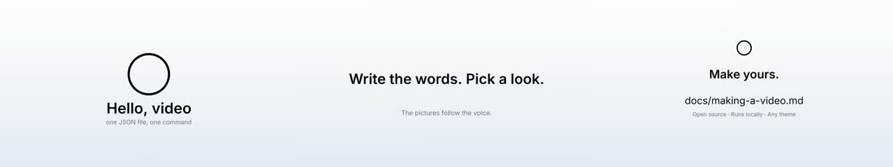

16:9 · paper theme · 17 s · 3 scenes (title, statement, outro)

```bash
video/scripts/build.sh --container --project examples/hello --theme paper --format 16:9
```

### scene-tour

All ten canvas scene types, one after another.


16:9 · midnight theme · 56 s · 10 scenes (title, statement, queue, parallel, map, stats, steps, code, compare, outro)

```bash
video/scripts/build.sh --container --project examples/scene-tour --theme midnight --format 16:9
```

### product-launch

A product launch: problem, before and after, numbers, steps.

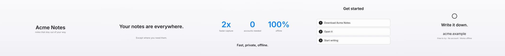

16:9 · clean theme · 33 s · 6 scenes (title, statement, compare, stats, steps, outro)

```bash
video/scripts/build.sh --container --project examples/product-launch --theme clean --format 16:9
```

### release-notes

Release notes: a statement per feature, then the numbers.

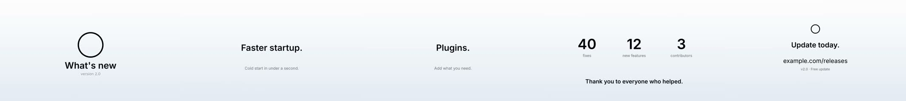

16:9 · paper theme · 31 s · 6 scenes (title, statement, stats, outro)

```bash
video/scripts/build.sh --container --project examples/release-notes --theme paper --format 16:9
```

### social-teaser

A fifteen-second vertical teaser for Shorts, Reels and TikTok.

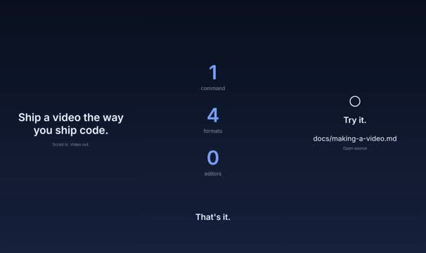

9:16 · midnight theme · 14 s · 3 scenes (statement, stats, outro)

```bash
video/scripts/build.sh --container --project examples/social-teaser --theme midnight --format 9:16
```

### tutorial-chalk

A tutorial on a chalkboard: a plan and the commands.

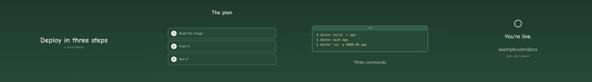

16:9 · chalk theme · 21 s · 4 scenes (title, steps, code, outro)

```bash
video/scripts/build.sh --container --project examples/tutorial-chalk --theme chalk --format 16:9
```

### architecture-blueprint

An architecture explainer in blueprint style.

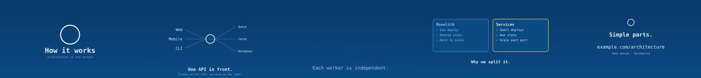

16:9 · blueprint theme · 29 s · 5 scenes (title, map, parallel, compare, outro)

```bash
video/scripts/build.sh --container --project examples/architecture-blueprint --theme blueprint --format 16:9
```

### oss-announcement

An open-source announcement for a 4:5 feed.

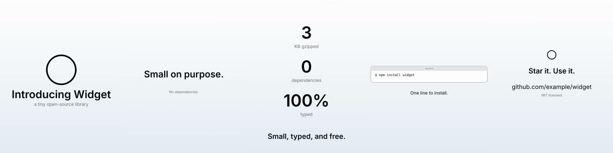

4:5 · paper theme · 27 s · 5 scenes (title, statement, stats, code, outro)

```bash
video/scripts/build.sh --container --project examples/oss-announcement --theme paper --format 4:5
```

### changelog-month

A monthly update, square, with numbers and highlights.


1:1 · midnight theme · 21 s · 4 scenes (title, stats, steps, outro)

```bash
video/scripts/build.sh --container --project examples/changelog-month --theme midnight --format 1:1
```

### code-walkthrough

Code that types itself: install, then verify.

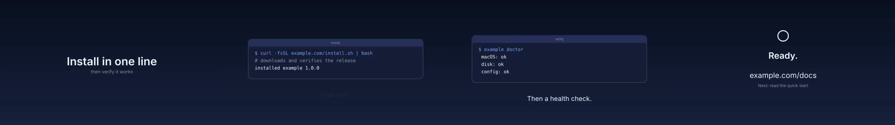

16:9 · midnight theme · 23 s · 4 scenes (title, code, outro)

```bash
video/scripts/build.sh --container --project examples/code-walkthrough --theme midnight --format 16:9
```

### kinhin-30s

kinhin in thirty seconds, with the kinhin adapter's recorded app clip in a laptop.

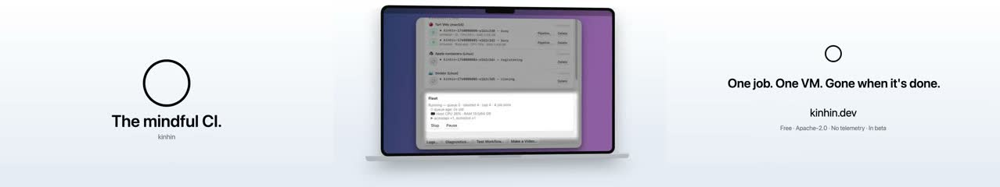

16:9 · paper theme · 23 s · 3 scenes (title, device, outro)

```bash
video/scripts/build.sh --container --project examples/kinhin-30s --theme paper --format 16:9
```

### template-demo

The template adapter: an app clip in a laptop, a browser session and a terminal, each in its frame.

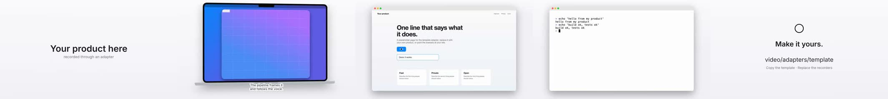

16:9 · clean theme · 33 s · 5 scenes (title, device, terminal, outro)

```bash
video/scripts/build.sh --container --project template-demo --theme clean --format 16:9
```

### launch

The kinhin launch video: seven scenes, a recorded app, voice-over and music.

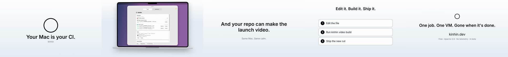

16:9 · paper theme · 76 s · 7 scenes (title, queue, parallel, device, terminal, map, outro)

```bash
video/scripts/build.sh --container --project launch --theme paper --format 16:9
```

## Themes

One project, five looks: change a flag, not the script. A theme sets the font, the colours, the backdrop, the laptop and
window, and the captions. Make your own by copying a file in `video/themes/`.

### blueprint

The hello example in the blueprint theme.

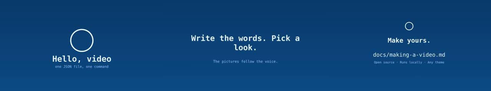

16:9 · blueprint theme · 17 s · 3 scenes (title, statement, outro)

```bash
video/scripts/build.sh --container --project examples/hello --theme blueprint --format 16:9
```

### chalk

The hello example in the chalk theme.

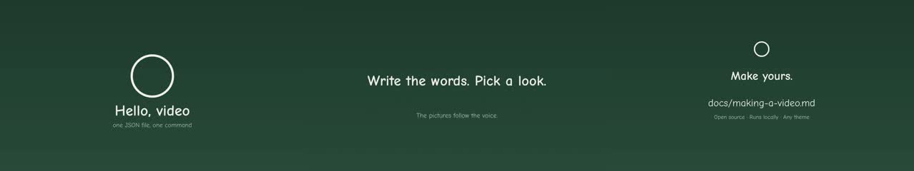

16:9 · chalk theme · 17 s · 3 scenes (title, statement, outro)

```bash
video/scripts/build.sh --container --project examples/hello --theme chalk --format 16:9
```

### clean

The hello example in the clean theme.

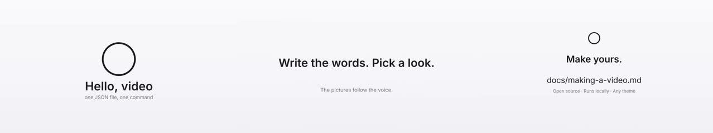

16:9 · clean theme · 17 s · 3 scenes (title, statement, outro)

```bash
video/scripts/build.sh --container --project examples/hello --theme clean --format 16:9
```

### midnight

The hello example in the midnight theme.

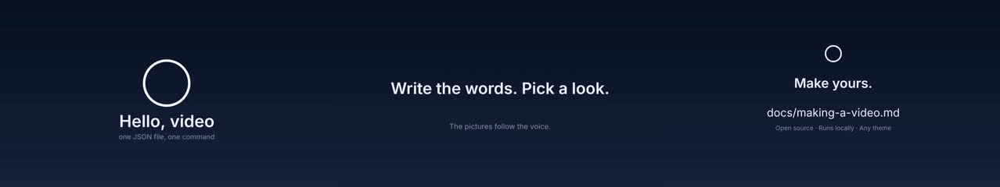

16:9 · midnight theme · 17 s · 3 scenes (title, statement, outro)

```bash
video/scripts/build.sh --container --project examples/hello --theme midnight --format 16:9
```

### paper

The hello example in the paper theme.


16:9 · paper theme · 17 s · 3 scenes (title, statement, outro)

```bash
video/scripts/build.sh --container --project examples/hello --theme paper --format 16:9
```

## Captions

The same scene with captions off and in each style. Burned-in captions are a project setting (`captions` in the JSON) or a flag
(`--captions off`, `--caption-style box`); the caption file is written either way. See
[Captions](videos-for-your-project.md#captions).

### Captions off

No burned-in captions; the .srt is still written.


16:9 · clean theme · 33 s · 5 scenes (title, device, terminal, outro)

```bash
video/scripts/build.sh --container --project template-demo --theme clean --format 16:9 --captions off
```

### Captions: outline

Text with a contrasting outline (the default).

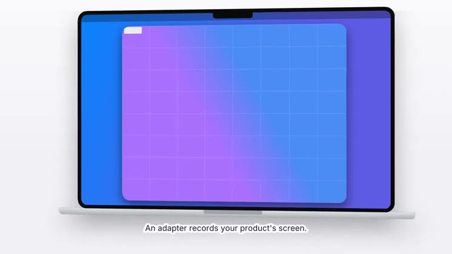

16:9 · clean theme · 33 s · 5 scenes (title, device, terminal, outro)

```bash
video/scripts/build.sh --container --project template-demo --theme clean --format 16:9 --caption-style outline
```

### Captions: box

Text on a semi-transparent box.

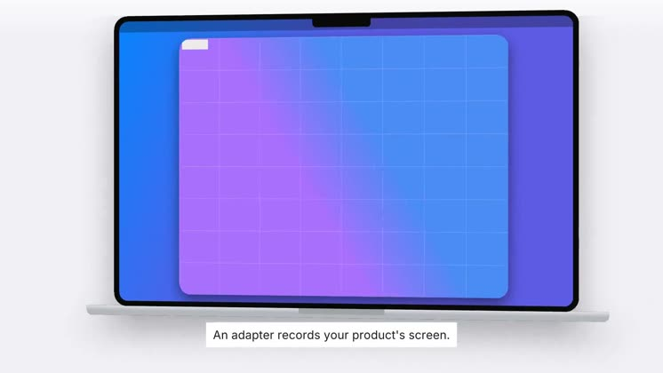

16:9 · clean theme · 33 s · 5 scenes (title, device, terminal, outro)

```bash
video/scripts/build.sh --container --project template-demo --theme clean --format 16:9 --caption-style box
```

### Captions: shadow

Text with a soft drop shadow, no outline.

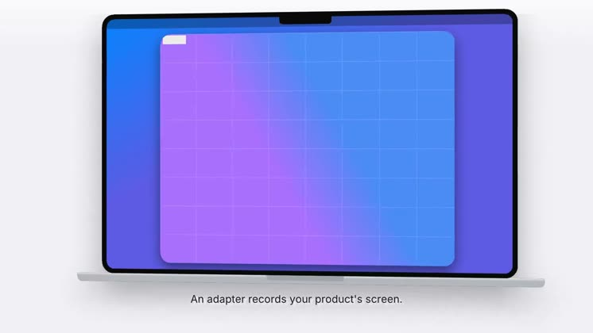

16:9 · clean theme · 33 s · 5 scenes (title, device, terminal, outro)

```bash
video/scripts/build.sh --container --project template-demo --theme clean --format 16:9 --caption-style shadow
```

### Captions: bold

Larger, bold text with an outline.

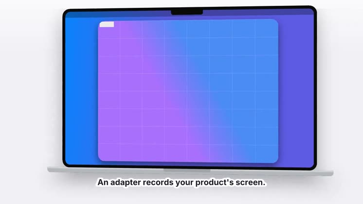

16:9 · clean theme · 33 s · 5 scenes (title, device, terminal, outro)

```bash
video/scripts/build.sh --container --project template-demo --theme clean --format 16:9 --caption-style bold
```

### Captions: minimal

Small, plain text.

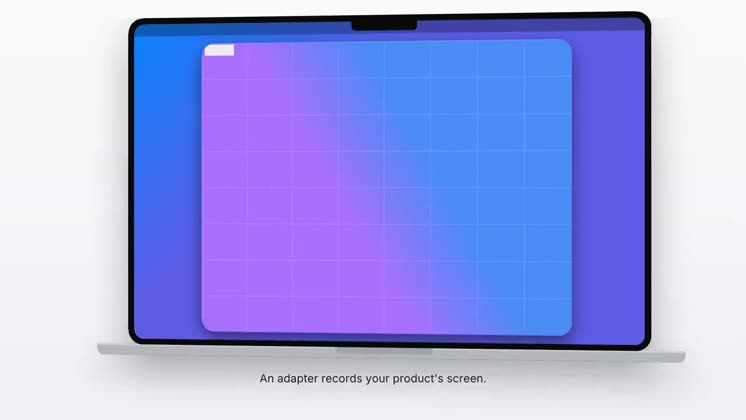

16:9 · clean theme · 33 s · 5 scenes (title, device, terminal, outro)

```bash
video/scripts/build.sh --container --project template-demo --theme clean --format 16:9 --caption-style minimal
```

## Formats

One project, four frames. Portrait and square frames get their own layouts.

### 16:9

The hello example at 16:9 (YouTube, the web, a site hero).


16:9 · paper theme · 17 s · 3 scenes (title, statement, outro)

```bash
video/scripts/build.sh --container --project examples/hello --theme paper --format 16:9
```

### 9:16

The hello example at 9:16 (Shorts, Reels, TikTok).

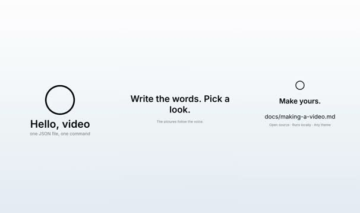

9:16 · paper theme · 17 s · 3 scenes (title, statement, outro)

```bash
video/scripts/build.sh --container --project examples/hello --theme paper --format 9:16
```

### 4:5

The hello example at 4:5 (Instagram and LinkedIn feeds).

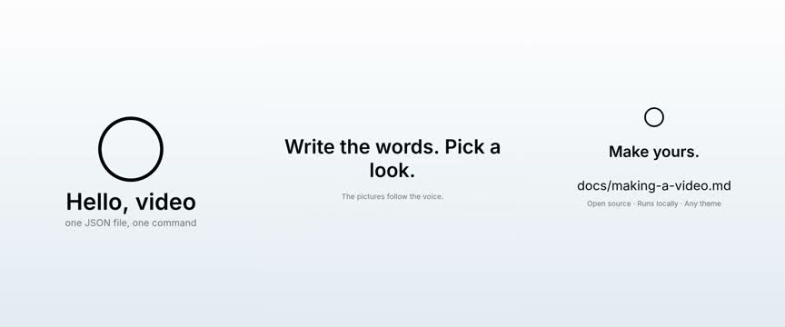

4:5 · paper theme · 17 s · 3 scenes (title, statement, outro)

```bash
video/scripts/build.sh --container --project examples/hello --theme paper --format 4:5
```

### 1:1

The hello example at 1:1 (Square).

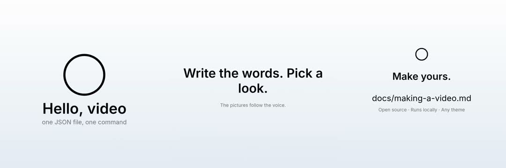

1:1 · paper theme · 17 s · 3 scenes (title, statement, outro)

```bash
video/scripts/build.sh --container --project examples/hello --theme paper --format 1:1
```
